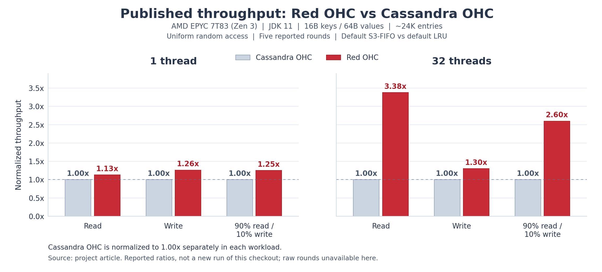

# Benchmark protocol

## Published results

The [project article](https://mp.weixin.qq.com/s/gKQneNQRDOFSSVueQWvq3A) reports a
five-round comparison of Red OHC and Cassandra OHC. The following values come
from that article; they were not measured again on this checkout.

| Setting | Reported configuration |
| --- | --- |
| CPU | AMD EPYC 7T83, Zen 3 |
| JDK | 11 |
| Heap / native memory budget | 1 GB / 1 GB |
| Key / value size | 16 B / 64 B |
| Working set | Approximately 24,000 entries |
| Access distribution | Uniform random |
| Red OHC policy | Default S3-FIFO |
| Cassandra OHC policy | Default LRU |
| Measurement | JMH throughput mode, five rounds |

Ratios are Red OHC throughput divided by Cassandra OHC throughput; Cassandra OHC
is the 1.00x reference in each row.

| Workload | Threads | Reported throughput ratio |
| --- | ---: | ---: |
| Read | 1 | 1.13x |
| Write | 1 | 1.26x |
| 90% read / 10% write | 1 | 1.25x |
| Read | 32 | 3.38x |
| Write | 32 | 1.30x |
| 90% read / 10% write | 32 | 2.60x |



Both panels use the same scale, with Cassandra OHC normalized to 1.00x for each
workload. Ratios compare engines within a workload; the chart does not compare
absolute throughput between workloads. Raw rounds are unavailable here, so the
chart has no error bars.

A separate JMH GC-profiler measurement used 32 read threads and three
3-second measurement rounds. Its published observations are:

| Metric | Cassandra OHC | Red OHC |
| --- | ---: | ---: |
| Heap allocation per read | Approximately 32 B/op | Approximately 0.001 B/op |
| GC count in that measurement | 22 | 0 |

These observations describe the measured read workload and profiling window.
Serializers that materialize application objects can allocate on the Java heap.
The GC measurement is separate from the five-round throughput comparison.

Artifact hashes, source SHAs and raw per-round results are not included with
this table. It records a sourced comparison, not acceptance evidence for
current main or the six-framework protocol below. Reproducing the exact run
also requires the measured artifacts and complete JMH settings. The source
text does not report CPU cost per completed operation or a matched total-memory
comparison. The heap allocation numbers above do not represent total process
memory, and the ratios do not establish end-to-end application QPS.

## Six-framework comparison

The primary comparison is `FairSerializedBenchmark.operation`, with six isolated
runtime graphs: [Red OHC](https://github.com/Red-EAD/red-ohc), upstream
[snazy/OHC](https://github.com/snazy/ohc) 0.7.4 (linked implementation),
[Ehcache](https://github.com/ehcache/ehcache3) 3.10.8,
[MapDB](https://github.com/jankotek/mapdb) 3.1.0 (direct-memory DB, 16 hash-map segments),
[Chronicle Map](https://github.com/OpenHFT/Chronicle-Map) 3.27ea1 and
[Redis](https://github.com/redis/redis) via Jedis 5.0.2. Redis's installed server
version must also be recorded. [Caffeine](https://github.com/ben-manes/caffeine)
and engine-specific microbenchmarks remain
developer diagnostics, not additional members of this six-framework ranking.

All adapters use ordinary synchronous get/put APIs and full `byte[]` values.
They do not patch engine internals, preencode only one backend, simulate eviction
in Chronicle, or flush one cache on every operation. Keys and values are generated
before timing. Identical key-array instances are reused across lookups; this
matches Ehcache's native Java key equality/hash contract for arrays. This suite
does not claim equivalent behavior for freshly allocated equal array keys.

`MATERIALIZE` reads return the complete owned array and pass it to JMH's
Blackhole. Red OHC does not use the lightweight first-byte codec from its tuning
benchmark. `FULL_SCAN` additionally calculates the same checksum over every byte
for all adapters. Report the two consumption modes separately: scanning can
dominate cache lookup cost. There is no artificial extra copy on just one backend.

Default data: 32-byte keys, 5120-byte values, 24,576 keys, UNIFORM distribution.
Resident mode preloads and verifies every entry; if capacity is insufficient it
fails setup. Reads, replacement writes and 90:10 mixtures use the same precomputed
access sequence. ZIPF_099 and other key/value sizes form separate experiments.

The default resident group disables TTL. Native byte capacities are configured
for Red OHC, snazy/OHC, Ehcache and Redis; MapDB uses an entry expiry target and
Chronicle is sized by entry count. The default 256 MiB allows the resident data to
fit; it is **not an equal RSS budget**. Redis has server/allocator overhead and
network/client costs, and belongs in an end-to-end column rather than a local
lookup-only winner table. Its synchronous GET/SET use no pipeline.

The `PRESSURE` group preloads 19,660 entries and uses the larger key universe for
reads and finite-key churn writes (the prior MIXED shape). Explicitly configure
and report each engine's native capacity contract and steady resident count;
byte limits and MapDB's entry target are not interchangeable. Do not label a
run as eviction pressure unless the measurements confirm eviction actually
occurs. Chronicle's native TTL/eviction comparison is N/A and is excluded.
The `TTL` group requires positive TTL and reports expiry/misses separately;
never use it as the resident throughput ranking.

Red OHC's void put has no synchronous admission acknowledgement. Completed
operations mean the API returned; they do not prove durable admission. snazy/OHC's
false return is counted as a reported rejection. The other void APIs likewise
cannot establish admission from completion. Log attempted/completed, hits/misses,
writes, reported rejections and errors. Normal resident runs require reconciliation
and zero unexpected rejection/error. Residency and native/RSS trends must be
checked separately after repeated churn.

## Preparing and running

Use Python 3.9+ and the same JDK/JVM options, logical CPUs/affinity, workload,
capacity configuration and seed for all matched processes. On Linux, preserve
governor, NUMA placement, allocator and background-load information. Do not
compare backend graphs from the all-dependencies compiler/test classpath.

The runner and JMH tests share the module access options in the JMH POM,
following [OpenHFT's Java guidance](https://github.com/OpenHFT/OpenHFT/blob/ea/docs/Java-Version-Support.adoc).
The runner applies these same options to every backend, in addition to the
selected `--jvm-args`. Chronicle's JDK 21 round trip is tested rather than skipped.

```bash
python3 scripts/run_fair_benchmarks.py --output /path/to/results --prepare
python3 scripts/run_fair_benchmarks.py --output /path/to/results --run \
  --threads 1 8 32 --workloads READ_100 WRITE_100 READ_90_WRITE_10
```

Without `--run`, the tool only prints the plan (and builds if `--prepare` is
requested); it executes no benchmark. Formal runs are serial, five rounds with a
deterministic shuffled backend order, each process one fork, warmup 3 x 5s and
measurement 5 x 10s. Existing tuning methods such as `OHCSerializedBenchmark`
remain separate, selected explicitly by regex rather than included in this run.

Prepare from the exact clean commit to measure. The tool reads the current
project version, builds fresh artifacts, and writes a receipt binding the source
SHA, compiler JDK and JAR checksums. Formal execution rejects dirty source,
mismatched receipts or changed artifacts; rerun preparation after any commit.

The tool resolves each backend with `tools/benchmark-runtime/pom.xml`, records its
dependency tree/classpath, uses the thin benchmark JAR and adds only that backend's
runtime libraries. MapDB's published version ranges are pinned reproducibly in
both compilation and runtime graphs. It saves the commit, dirty status, JDK,
parameters, all JAR SHA-256 values, order, raw JMH JSON/logs, wall time, available
user/system child CPU and logical CPU count. Child CPU includes the fork and
owned Redis server; sampled Linux per-process CPU/RSS are lower bounds, not exact
final CPU totals. Normalized CPU is total CPU / wall / logical CPUs. Record
affinity and effective CPU availability separately when restricted.

Redis must be installed explicitly. The adapter starts its own loopback process
with persistence disabled, a temporary directory and a random password; it does
not accept an external host/port and never flushes or reconfigures an existing
server. Each raw run records the authenticated server's actual version, maxmemory
and owned PID without retaining its random password. Startup failures and Trial
teardown close all owned resources. Core
Invocation benchmarks retain their internal stop/join/native-accounting teardown.

Preparation does not establish benchmark correctness under long contention,
cross-platform native compatibility or Linux x86-64 performance. Run dedicated
Linux experiments after approval, retain all rounds, investigate stable regressions
and publish limitations alongside results. No results from this six-framework
suite are included here.

## Paired revisions across JDKs

`scripts/run_paired_benchmarks.py` compares Red OHC revisions through the existing
`OHCSerializedBenchmark` tuning entry, separately from the six-framework suite.
BASE is fixed at `306f87b0e2d36f1e8fc02b2024cc889be9a24535`; NEW must be a clean,
committed descendant. It exports both Git trees outside the checkout, builds both
with the supplied Java 11, checks application class-file version 55, and copies
the thin JMH JAR plus the existing RED runtime dependency graph into distinct
artifact directories. The private Maven repositories keep SNAPSHOT coordinates
from overwriting the other revision. Preparation records the compiler, source
SHAs and every JAR checksum. Measurement checks those checksums before every run.
Neither command rewrites the source checkout or its Git history.

Preview without building or running anything:

```bash
python3 scripts/run_paired_benchmarks.py
```

On a dedicated Linux x86-64 machine, after committing the exact NEW revision:

```bash
python3 scripts/run_paired_benchmarks.py --prepare \
  --output /srv/results/red-ohc-paired \
  --jdk-homes /opt/jdk-11 /opt/jdk-17 /opt/jdk-21 /opt/jdk-25
python3 scripts/run_paired_benchmarks.py --run \
  --output /srv/results/red-ohc-paired \
  --jdk-homes /opt/jdk-11 /opt/jdk-17 /opt/jdk-21 /opt/jdk-25
```

Preparation requires a fresh output directory. A run creates a fresh `runs/`
directory and never overwrites an earlier experiment. It refuses execution on
macOS, Windows or non-x86-64 Linux. `--new-ref` selects a committed revision;
`--jvm-args` replaces the common JVM options for both revisions and all four JDKs.
The defaults use G1, a 1 GiB heap and a 1 GiB direct-memory limit. The same
prepared bytes run on Java 11, 17, 21 and 25; both the controller and fork use the
selected Java binary. This dedicated-machine runner is never invoked implicitly
by CI or local smoke tests. CI uses the separate protocol below.
The runner overrides annotation append/prepend arguments and checks the actual
fork JVM, version, arguments and workload parameters in JMH's result metadata;
custom heap/direct-memory settings cannot silently revert to annotation defaults.

| Scenario | Existing method | Threads | Workload |
| --- | --- | --- | --- |
| read_t1 | oneThread | 1 | READ_100 |
| read_t32 | cpuThreads | 32 | READ_100 |
| write_t8 | cpuThreads | 8 | WRITE_100 |
| mix_t8 | cpuThreads | 8 | READ_90_WRITE_10 |

Each scenario uses UNIFORM and MIXED with four key/value byte pairs: 32/5120,
32/64, 32/16384 and 1024/5120. Capacity is calculated by the existing allocator
weight formula for 19,660 resident entries; the universe remains 24,576 keys and
TTL remains ten minutes. Generic reads use the existing lightweight first-byte
codec. These are lookup/allocation tuning experiments, not full-value bandwidth
or full-materialization comparisons. Use the existing direct full-scan/copy
methods separately when investigating large-value memory bandwidth.

Every case has five adjacent BASE/NEW pairs with alternating order, one fork per
process, warmup 3 x 5s and measurement 5 x 10s. The full matrix contains 640 serial
processes and is a dedicated-machine experiment. Keep CPU governor, NUMA/affinity,
native allocator and background load stable and record them alongside the manifest.

Each process retains the exact command, JMH JSON/log, completed/attempted counters,
wall time, user/system child CPU, logical CPU count, affinity and sampled per-process
CPU/RSS. Whole-process CPU includes startup, warmup and teardown. Existing measured
CPU windows separately record the five measurement intervals; CPU per completed
operation is an estimate from those windows and the measured completion throughput.
Missing CPU data is reported as unavailable, not zero. RSS samples are lower bounds;
they are not exact peaks or a per-entry heap measurement. Normalized whole-process
CPU uses the machine logical CPU count; affinity is recorded separately.

The runner rejects errors, reported rejections, partial measurements and
attempted/completed or attempted/accepted write mismatches in any iteration,
even if their aggregate averages agree. A 300-second per-process limit, interrupt
handling and process-group termination prevent abandoned forks. Completed pairs
are retained in `summary.json`; incomplete cases are marked incomplete. No fixed
regression threshold or automatic acceptance verdict is generated. Evaluate
throughput, CPU per completed operation and memory separately for each JDK and
size; investigate repeatable regressions without cancelling them against gains
elsewhere. Cross-platform CI and passing layout tests do not establish Linux
performance. Current-main paired Linux performance acceptance remains pending
until matched results exist.

## CI performance warnings

The **Red OHC CI** workflow compares each non-draft PR with its main base after
correctness tests. Jobs have names that identify their role, platform and JDK:

- `Core & JMH / Linux / JDK 11` (and the other OS/JDK combinations): correctness.
- `Performance / Linux / JDK 21 / read_t1` (and the other selected cases): measurement.
- `Quality / Linux / JDK 21`: requires that platform's JDK 21 correctness and every
  selected performance case to succeed exactly once.
- `Concurrency / JCStress` and `Example / User cache`: their named validation tasks.

There are still 14 required checks: the nine JDK 11/17/25 correctness checks,
three JDK 21 quality gates, concurrency and the example. All twelve correctness
jobs still run. The main ruleset and publishing tools use the new check names;
strict main synchronization and the maintainer's merge decision remain unchanged.
A throughput or estimated CPU/op ratio at or beyond 0.90 or 1.10 emits a warning
in either direction. Performance warnings, including `INCONCLUSIVE`, keep the
measurement job successful. Build failures, crashes, timeouts, allocation
failures, wrong artifacts/configuration and operation reconciliation failures
fail the affected platform's required quality gate.

Main pushes run correctness checks and report performance as `NOT_MEASURED`.
Draft PRs, non-measurement JDK jobs and changes limited to the allowed document,
image and community files also report `NOT_MEASURED`. Unknown files and build,
workflow, source or tool changes are measured conservatively. Changing a draft
to ready triggers fresh CI through `ready_for_review`.
When measurement is disabled, one lightweight `Performance / NOT_MEASURED` job
runs instead of the measurement matrix. It records the decision without setting
up Java, Maven or performance dependencies. Each quality gate requires this job
to succeed; stable publishing continues to reject all skipped or failed jobs.

### Workloads and memory budget

`scripts/run_ci_performance.py` uses `OHCSerializedBenchmark` with these five cases:

| Case | Threads | Workload |
| --- | --- | --- |
| read_t1 | 1 | READ_100 |
| write_t1 | 1 | WRITE_100 |
| read_parallel | P | READ_100 |
| write_parallel | P | WRITE_100 |
| mix_parallel | P | READ_90_WRITE_10 |

`P` equals the runner's available logical CPU count, with no reserved core or
fixed cap. Single-thread cases still use one worker. The maintenance actor and
JVM threads add CPU demand, so matching workers to vCPUs does not eliminate
scheduling contention. The manifest records the actual CPU count and workers.
All cases use 32-byte keys, 5,120-byte values, UNIFORM distribution and MIXED
writes. The existing 24,576-key universe, capacity formula for 19,660 entries,
ten-minute TTL and lightweight first-byte read codec apply. This measures
lookup/allocation behavior, not full-value materialization or memory bandwidth.

Each measurement fork uses these arguments on every platform:

```text
-Xms2g -Xmx2g -XX:MaxDirectMemorySize=2g -XX:+UseG1GC
```

The JMH controller uses `-Xms64m -Xmx256m`. The runner clears annotation append
and prepend arguments, removes inherited Java option variables and validates
the fork JVM, arguments, JDK, workload and iteration settings in the actual JMH
JSON. This prevents the benchmark's 1 GiB annotation defaults from taking effect.

The tool samples the combined RSS of its controller and fork once per second and
records the peak without imposing an RSS limit. Sampling can miss brief peaks.
Each process JSON also retains guest-wide CPU busy samples, cumulative CPU times
and OS load averages at one-second intervals plus process exit. The first busy
sample is unavailable while the non-blocking sampler establishes its baseline.
Unavailable diagnostics remain null; Windows has no OS load-average sample.
Linux CPU times include steal and iowait when exposed by the guest. These samples
include the benchmark's own CPU demand and do not expose the physical host's
other tenants. A high load average alone does not establish external contention.
OHC's `mmap`/`VirtualAlloc` pages are outside `MaxDirectMemorySize`.
Performance jobs use the standard macOS 26 Intel runner (four logical CPUs,
14 GB RAM), while the macOS correctness matrix continues on Apple Silicon.
The 2 GiB heap budget is identical across platforms; public Linux and Windows
standard runners provide 16 GB.
See [GitHub's runner specifications](https://docs.github.com/en/actions/reference/runners/github-hosted-runners).
Daily macOS performance results cover Intel, and do not establish Apple Silicon
performance. The runner change is a stability experiment: macOS ARM calibration
showed large within-fork variation even in read-only windows with no GC and
little JIT activity. Those observations do not identify a specific host or
scheduler cause, and Intel virtualization can also introduce variability.
POSIX process groups and a private Windows Job Object retain ownership even
when a controller exits before its fork is sampled. Windows starts the controller
suspended, assigns it to the kill-on-close job, then resumes its primary thread.

### Immutable builds and pairing

Automatic comparisons use the PR event's base SHA for BASE and the tested merge
SHA for NEW. The report also records the PR head SHA. The current PR's measurement
tools run with the repository's normal review trust boundary; they are not an
independent attestation of an adversarial PR. Tooling changes are prominently
flagged, including during A/A calibration.

Both core revisions are built with the same Java 11 and the same Maven executable
on that platform. Builds use separate local Maven repositories and Java 11
bytecode. One thin benchmark harness, built from BASE, is reused byte for byte
with both cores. Each core resolves its own runtime dependencies through BASE's
runtime resolver. The resolved core must match the freshly built JAR, even when
a matching release coordinate already exists in Central. Receipts include every
runtime JAR checksum, compiler/runtime details and Maven version; artifact bytes
are rechecked before every measurement process.
For A/A calibration both labels execute the same prepared artifact bytes.

Each OS/JDK/scenario combination runs in a separate runner VM; the five scenarios
can run concurrently without competing for CPUs inside one VM. BASE and NEW
execute serially in that same VM, adjacent within each pair, with AB/BA order
alternating by round. Each scenario starts with three independent pairs. Every
process has one fork, three 10-second warmup iterations and five 9-second
measurement iterations: 7 minutes 30 seconds of pure screening per scenario.

A case that reaches either 10% threshold or has inconclusive screening receives
exactly one independent confirmation batch: three pairs, three 15-second warmup
iterations and five 9-second measurement iterations. This adds nine minutes of
pure measurement/warmup, for 16 minutes 30 seconds per scenario including both
batches. Builds, startup and teardown add time. Batches are retained separately,
without pooling, trimming outliers or retrying until a desired result appears.
The two batches launch at most 12 forks. The three initial pairs give fewer
independent samples than five pairs; longer iteration windows and fewer process
starts do not establish that a hosted VM has reached steady state.

A regular PR targets completion within 30 minutes: correctness first, then the
15 JDK 21 scenario jobs, followed by three required quality gates. Each scenario
has a 25-minute performance-phase watchdog, a 26-minute step ceiling and a
27-minute job ceiling; each launched measurement process has a four-minute
limit. PR measurement also stops at 28 minutes from the current workflow
attempt's start, leaving room for uploads and gates. A rerun receives a fresh
attempt budget. Timeout is a real error, not a performance warning or successful
unmeasured result. Cloud queue delays and service outages can still exceed the
30-minute target; job timeouts alone are not a workflow-wide wall-clock guarantee.

The Free plan permits 20 concurrent standard jobs and five macOS jobs, so one
regular PR's five macOS scenarios fit that quota. Other workflows may compete for
those slots. See [GitHub Actions limits](https://docs.github.com/en/actions/reference/limits).
Manual four-JDK experiments can queue additional waves and are outside the
regular-PR 30-minute target. Their individual scenario deadlines still apply.

### Statistical and CPU interpretation

The statistical unit is an independent fork pair. The tool takes the mean of
the log NEW/BASE ratios and exponentiates it for the geometric mean ratio.
A Student t interval on those paired log ratios provides each scenario's 95%
interval. Iterations inside one fork are not counted as independent processes.
These are individual scenario intervals, not a simultaneous confidence claim
over all cases or JDKs. Hosted-runner scheduling noise remains a limitation.

Iteration throughput CV above 5%, first-two versus last-two iteration drift above
5%, or an interval crossing a 10% boundary makes that batch `INCONCLUSIVE`.
One noisy fork is sufficient; samples are never discarded. A clean independent
confirmation whose interval stays within both thresholds can resolve initial
uncertainty only when the initial point estimate was also within both thresholds.
A threshold-sized initial signal that is not reproduced, a new contradictory
signal, or uncertain confirmation remains `INCONCLUSIVE`. Both batches and all
initial quality flags stay visible even when confirmation resolves uncertainty.
An unavailable CPU measurement is
`N/A`, never a zero-cost operation.

Reports distinguish per-fork quality flags, paired intervals crossing a 10%
boundary, and an initial threshold signal not independently reproduced. These
explanations do not alter the verdict rules. Guest CPU/load alone cannot identify
interference. A read-only process census every ten seconds records the five
largest observed outside-tree CPU consumers by name and PID/create-time identity,
without command arguments. CPU deltas exclude the launched process tree and the
observer; rates use each process's monotonic observation interval and are
estimates with partial coverage because short-lived, new or unreadable processes
may be absent. The iterator cache is cleared for fresh PID/create-time identities.
The first census has no CPU-rate estimate. Per-call wall durations
separate slow OS introspection from long sampling intervals. All monitoring CPU
remains included in the observer cost. No system service or unrelated process is
stopped, reprioritized or reconfigured by the measurement tool.

The JMH auxiliary counters are **operation rates**, not raw operation counts.
For each fork, estimated CPU/op is:

```text
sum(measurement-window process CPU seconds)
--------------------------------------------------------------
sum(completed operations/second[i] * measurement wall seconds[i])
```

Process CPU includes the maintenance actor and excludes process startup and
warmup. Window setup/teardown skew makes this an estimate. Whole-process sampled
user/system CPU, wall time and normalized CPU are separate diagnostics; sampled
CPU totals are lower bounds. Throughput increases and CPU/op decreases indicate
improvement, so their warning directions differ.

Process-tree/RSS and guest CPU/load sampling runs once per second; deadline and
cancellation polling remains responsive at 100 ms. There is no RSS failure cap.
The tool records its own Python CPU separately across launch, warmup, measurement
and cleanup, so observer overhead is not mistaken for benchmark CPU.
Unreadable child command metadata is recorded as unknown with its reason;
primary sampling and process-control errors still fail the job.
Guest load includes this benchmark and cannot by itself establish interference from other
workloads. JMH's built-in `gc` and `comp` profilers retain per-iteration allocation,
collection and compilation diagnostics in their original units, separately from
operation rates. Missing or unsupported diagnostics remain `N/A`. These lightweight
profilers are enabled identically for BASE and NEW; their overhead is part of this
CI protocol, not directly comparable to historical runs without them. Longer
warmup reduces one source of drift but does not prove steady state or explain all
hosted-runner variability.

Every iteration must reconcile attempted/completed operations and
attempted/accepted writes, with zero exceptions, incomplete operations or
unexpected rejections. Aggregate agreement cannot hide a bad iteration.

Actions Summary shows both batches, absolute geometric means, ratios, intervals
and verdicts, plus per-fork CV/drift, GC/compilation and observer CPU diagnostics.
Artifacts retained for 90 days contain raw JMH JSON/logs, operation
rates, CPU windows, sampled process/RSS data, SHAs, complete commands, image/CPU/
JDK descriptions and build receipts. Partial evidence is retained on errors.

### Manual comparisons and calibration

Use the **Red OHC CI** workflow's **Run workflow** control on the intended
branch. Supply full 40-character BASE and NEW commit SHAs for a measurement:

| `performance` | Behavior |
| --- | --- |
| `off` (default) | Correctness only |
| `jdk21` | Compare on JDK 21 across all three OS jobs |
| `all-jdks` | Compare separately on JDK 11, 17, 21 and 25 across all three OSes |
| `aa-jdk21` | JDK 21 calibration with identical BASE/NEW SHAs |

The runtime JDK is captured before switching to Java 11 for compilation. Every
controller and fork explicitly uses that saved runtime. A manual run is a
diagnostic comparison; it does not replace the main-push CI evidence required
by publication tools. It never triggers a formal release.

Python 3.12 tooling dependencies are isolated and pinned with wheel hashes in
`scripts/ci-performance-requirements.txt`. They add no Java runtime dependencies.
Short protocol tests, including simulated high RSS and cancellation, run
without invoking a local Java benchmark:

```bash
python -m venv /path/to/performance-python
/path/to/performance-python/bin/python -m pip install --require-hashes --only-binary=:all: \
  -r scripts/ci-performance-requirements.txt
/path/to/performance-python/bin/python -m unittest discover -s scripts \
  -p 'test_*ci_performance*.py' -v
```

On Windows, use the environment's `Scripts/python.exe`. Hosted-runner warnings
support review; they do not establish dedicated Linux, Zen 4/4c or Intel
performance acceptance. That acceptance remains pending until matched machine
measurements exist.
